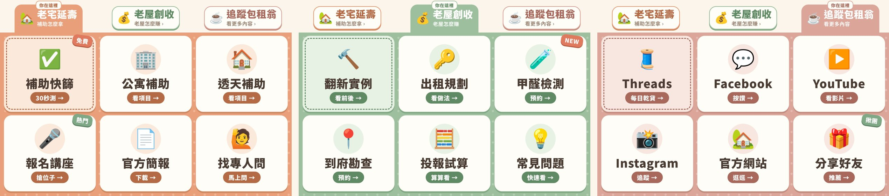

# LINE 官方帳號｜分頁式圖文選單（包租翁 MAX HOUSE）

選單上方三個分頁（杏橘／鼠尾草綠／奶茶玫瑰，暖色溫馨風），點了就切換，不用另外架伺服器。
每顆按鈕都有「按了會怎樣」的小標籤（例如「30秒測 →」「搶位子 →」），一看就懂：

| 分頁 | 6 顆按鈕 |
|---|---|
| 老宅延壽 | 補助快篩、公寓補助、透天補助、報名講座、官方簡報、找專人問 |
| 老屋創收 | 翻新實例、出租規劃、甲醛檢測、到府勘查、投報試算、常見問題 |
| 追蹤包租翁 | Threads、Facebook、YouTube、Instagram、官方網站、分享好友 |

> ⚠️ LINE 官方帳號後台（OA Manager）的「圖文選單」做不出分頁切換，一定要用 Messaging API。
> 用 API 建好的選單在後台看不到，但會優先於後台的預設選單顯示。

## 上架步驟（約 10 分鐘）

1. **拿 Token**：到 [LINE Developers](https://developers.line.biz/console/) → 你的官方帳號 Channel →
   Messaging API 分頁 → 最下面 **Channel access token (long-lived)** 按 Issue，複製。
   （若還沒啟用：OA Manager → 設定 → Messaging API → 啟用。）
2. **放圖片**：把 `images/tab1.jpg`、`tab2.jpg`、`tab3.jpg` 上傳到 Google 雲端硬碟，
   各自打開，網址 `/d/` 和 `/view` 中間那串就是檔案 ID。
3. **建 GAS**：到 [script.google.com](https://script.google.com) 新增專案，把 `richmenu.gs` 整份貼上。
   - 左側齒輪「專案設定」→ 指令碼屬性 → 新增 `LINE_TOKEN` = 第 1 步的 token
   - 程式上方 `IMAGES` 填三個檔案 ID
   - `LINKS` 填你的 Threads / FB / YouTube / IG 網址（留空的按鈕會改成「傳文字」）
4. 上方選 `deployAll` → 執行 → 第一次會要求授權（雲端硬碟、外部連線），允許即可。
5. 手機把官方帳號聊天室關掉再打開，就看到新選單了。

之後要改按鈕或換圖，改完再執行一次 `deployAll()` 就好（會自動刪掉舊的重建）。
不要了就執行 `removeAll()`。

## 「傳文字」按鈕要搭配自動回應

補助快篩、找專人問、甲醛檢測等按鈕，按下去會幫使用者送出一句話，例如「我想預約一對一諮詢」。
到 OA Manager → **自動回應訊息** 用同樣的關鍵字設定回覆（或回覆表單連結），就形成完整流程。

| 按鈕 | 送出文字 |
|---|---|
| 補助快篩 | 我想做老宅延壽補助快篩 |
| 找專人問 | 我想預約一對一諮詢 |
| 甲醛檢測 | 我想預約甲醛檢測 |
| 到府勘查 | 我想預約到府勘查 |
| 投報試算 | 我想做翻新投報試算 |
| 常見問題 | 常見問題 |

## 改圖片文字

改 `design.html` 裡的 `TABS` / `PAGES`，然後 `node render.js` 重新產出 `images/`。
按鈕順序要跟 `richmenu.gs` 的 `buildMenus_()` 一致。
